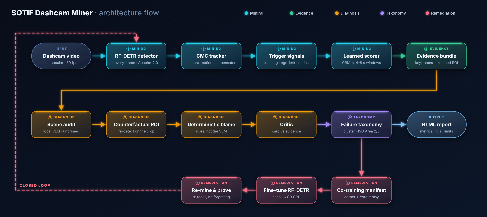

# SOTIF-Aligned Dashcam Edge-Case Miner & Causal Root-Cause Agent

> Turn raw monocular dashcam video into a **ranked, explained, safety-standard-tagged** catalog of the
> driving situations where perception is most likely to fail — the input an ADAS/AV team needs to
> decide what to fix next.


[](https://github.com/madhureddy25/SOTIF-Aligned/actions/workflows/ci.yml)

-success)


A fleet records thousands of hours of dashcam video. The valuable 1% — the near-misses, the
occluded pedestrian, the car that braked hard ahead — is buried in it. This system **finds those
moments automatically, explains *why* each was dangerous, and groups them into recurring failure
modes** mapped to the ISO 21448 (SOTIF) safety standard. It runs on a single laptop GPU and every
headline number is reported with a confidence interval and an honest limitations section.

---

## Headline result (real Nexar footage, 1,100 held-out clips the model never saw)

| Metric | Value | 95% CI |
|---|---|---|
| **Near-miss recall** | **0.88** | [0.86, 0.91] |
| Flagged **before** the official alert time | 0.65 | [0.61, 0.69] |
| Median early-warning lead | 3.1 s | [2.7, 3.4] |
| Video discarded (compression) | 0.65 | [0.64, 0.66] |
| False windows / minute (normal driving) | 3.2 | [3.1, 3.4] |
| VLM root-cause JSON validity | 99.8% | — |

The Stage-1 model was trained on 200 clips and tested on **1,100 disjoint clips** (550 near-miss / 550 normal).
5-fold cross-validation on the 200 training clips predicted recall 0.90 [0.84, 0.95] and early recall
0.67 [0.58, 0.76]; the 1,100-clip held-out test delivered 0.88 and 0.65 — both inside the CV intervals,
so **no overfitting.** An earlier 100-clip held-out test read 0.91 / 0.73; the larger test shows that 0.73
early recall was the outlier, so we report the 1,100-clip numbers.
141 events were diagnosed and consolidated into **21 ranked failure modes**.

### Does more training data help? (200 → 1,300 clips)

We retrained Stage 1 on all 1,300 mined clips and re-tested on the **same 200 held-out clips** (100 near-miss /
100 normal) that neither model saw:

| Same held-out clips | Trained on 200 | Trained on 1,300 | 1,300 + Stage-1 fixes |
|---|---|---|---|
| Recall | 0.91 [0.85, 0.96] | 0.91 [0.85, 0.96] | 0.95 [0.90, 0.99] |
| Flagged before alert | 0.73 | 0.76 [0.67, 0.84] | 0.78 [0.69, 0.86] |
| Median early-warning lead | 3.3 s | **4.2 s** [3.6, 5.2] | 3.5 s [2.7, 4.5] |
| False windows / minute | **3.1** [2.8, 3.4] | 3.4 [3.1, 3.8] | 3.8 [3.4, 4.2] |
| Video discarded | **0.67** [0.65, 0.69] | 0.63 [0.61, 0.66] | 0.60 [0.58, 0.63] |
| Step-level AUC (5-fold CV) | 0.855 | 0.851 | 0.850 |

**Finding: Stage 1 is feature-limited, not data-limited.** 6.5× more data left the model's discrimination
(AUC) unchanged; the retrained model sits at a different point on the *same* trade-off curve — earlier
warnings, slightly more false windows. The next gain must come from better signals, not more clips.
Cross-validation over all 1,300 clips agrees: recall 0.91 [0.89, 0.93], early recall 0.72 [0.68, 0.75],
3.2 false windows/min, 63% of video discarded. Fixing two Stage-1 bugs ([journal](docs/WHAT_WE_DID.md) #7, #8) also left AUC at 0.850 —
three independent changes, one ceiling. On the held-out clips the fixed model catches 95 of 100
near-misses (vs 91), paid for with more windows (3.8/min, 60% discarded) — again a move along the same
curve, and within the overlapping CIs of 100 clips.

---

## High-level architecture

<p align="center">
  
</p>

The five stages are **decoupled** and trade throughput for depth: cheap detection runs on every
frame; the expensive vision-language reasoning runs **only** on verified anomaly windows.

---

## Five things that make it different

1. **Zero-noise evidence gating.** The detector/tracker act as a *trigger and cropper*, not as prompt
   filler. The VLM sees semantically-downsampled frames + zoomed ROI crops — avoiding the documented
   "pipe raw detections into the prompt and inject noise" failure mode.
2. **Counterfactual optical-vs-model blame.** A second detection + VLM pass on the *enhanced crop*
   separates **aleatory** optical impossibility (glare/darkness → an operating-domain limit) from
   **epistemic** model blind spots (fixable with training data).
3. **Deterministic, auditable attribution.** The VLM never chooses the root cause — fixed rules over
   measurements do, and a critic rejects any card that contradicts the evidence. Reproducible by design.
4. **Honest evaluation.** Cross-validated *and* held-out numbers, each with bootstrap CIs; in-sample
   results are flagged, not reported; the Nexar anticipation benchmark is shown only as a labelled
   aside (it measures a different task).
5. **Anti-forgetting closed loop.** Mined failures are exported as a co-training manifest (corner cases
   mixed with core-replay frames) so detector fine-tuning raises corner-case recall without regressing
   on normal driving.

---

## Pipeline at a glance

| Stage | Does | Key tech | Status |
|---|---|---|---|
| ① Mining | Flag 4–8 s edge-case windows, discard routine video | RF-DETR · CMC-SORT · gradient boosting | ✅ validated (recall 0.88 on 1,100 held-out clips) |
| ② Evidence | Keyframes + zoomed ROI crops + telemetry | OpenCV · CLAHE | ✅ |
| ③ Diagnosis | Describe + attribute root cause, critic-checked | Qwen3-VL (local) · deterministic rules | ✅ 99.8% valid JSON |
| ④ Taxonomy | Cluster into ranked SOTIF-tagged failure modes | UMAP/PCA · HDBSCAN | ✅ 21 modes |
| ⑤ Remediation | Co-training manifest → fine-tune → prove gains | COCO export · RF-DETR train | ⚙️ machinery built (label-free + CODA-ready) |

---

## Quickstart

```bash
conda create -n sotif python=3.11 -y && conda activate sotif
pip install torch torchvision --index-url https://download.pytorch.org/whl/cu128
pip install -e ".[detect,dev]"
pytest -q                     # 73 passing
sotif-miner demo              # synthetic end-to-end, CPU, no weights/data
```

Run on real video (needs the [Nexar dataset](https://huggingface.co/datasets/empiricearth/nexar_collision_prediction)):

```bash
sotif-miner nexar    --root <data> --split train --config configs/nexar.yaml --out runs/train
sotif-miner diagnose --run runs/train --only positive          # local VLM via Ollama
sotif-miner taxonomy --runs runs/train --out runs/taxonomy
sotif-miner report   --run runs/train --taxonomy runs/taxonomy --out runs/report.html
```

Full step-by-step (Windows, including the held-out protocol and Phase 4): [`RUN_ON_WINDOWS.md`](RUN_ON_WINDOWS.md).

- 📋 **[What we built — project journal](docs/WHAT_WE_DID.md)** — everything done, and the honest failures we caught and fixed.
- 🗂️ **[Full build plan](docs/PLAN.md)**

---

## Design notes & honesty

- **Licensing:** RF-DETR (Apache-2.0) over AGPL YOLO; local VLMs via Ollama; nothing copyleft in the path.
- **What is validated:** mining recall *generalizes* (1,100-clip held-out ≈ cross-validated). Diagnosis is
  reproducible and critic-checked. Taxonomy consolidates real recurring modes.
- **What is *not* (and the report says so):** perception-failure causes aren't independently validated
  (Nexar has no detector-failure labels — that needs CARLA counterfactuals or human review); the
  domain is US/clear-day-heavy; this **mines** events in recorded video, it does **not predict** crashes
  before they are visible.
- **Localizer, not a clip classifier:** 93% of normal-driving clips still get at least one window. The
  value is in narrowing each clip to a few seconds (65% of video discarded, ~3 false windows/min), not in
  declaring whole clips safe.
- **High-recall mode:** the default threshold targets recall ≥ 0.9 with the most video discarded. For
  "miss nothing" triage, threshold 0.2 reaches **0.98 recall (0.88 before the alert)** while still
  discarding 38% of video (5-fold CV, 1,300 clips).

---

## Repository layout

```
src/sotif_miner/
  io/          video & frame readers
  datasets/    Nexar loader (+ held-out slicing)
  perception/  RF-DETR detector · CMC-SORT tracker · embedders
  mining/      4 signals · rolling scorer · learned Stage-1 model
  evidence/    keyframe compression · ROI crops · bundles
  vlm/         Ollama / vLLM / Claude / scripted backends · prompts
  diagnosis/   deterministic attribution · critic · 4-step agent
  taxonomy/    clustering · naming · Area 2/3
  remediation/ COCO manifest · fine-tune wrapper
  eval/        mining · bootstrap CIs · closed-loop
  report.py    self-contained HTML deliverable
  cli.py       mine · diagnose · taxonomy · train-stage1 · report · export-manifest · finetune · eval-closed-loop
tests/         73 CPU tests (gpu/network tests opt-in)
```

---

*Built iteratively and validated on real footage, correcting several honest failures along the way
(signal saturation on real video, in-sample overfitting, and an evaluation that measured the wrong
task) — each caught, fixed, and documented. Aligned with ISO 21448 (SOTIF) and Euro NCAP 2026 scenarios.*
